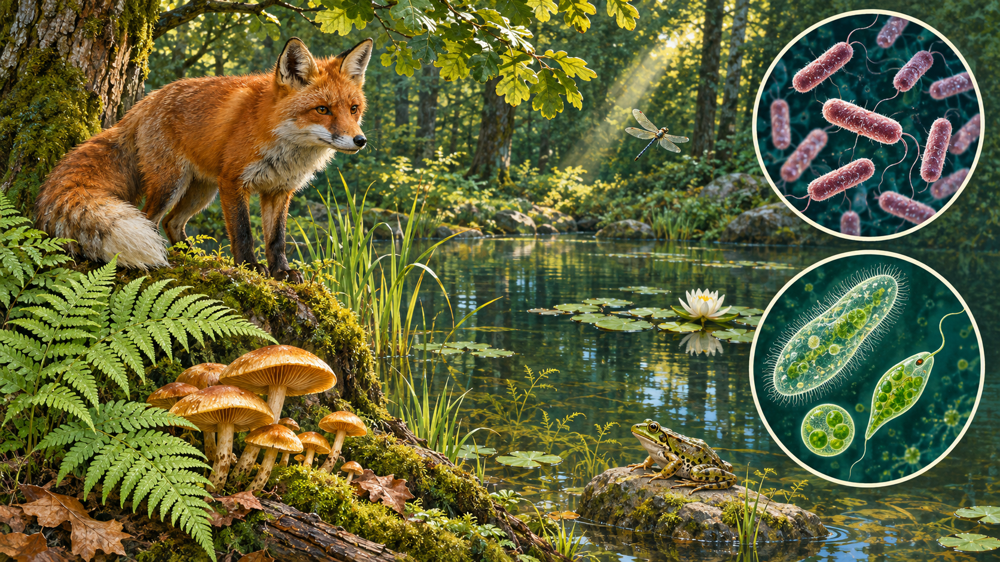

# Los cinco reinos de los seres vivos

**Biología · 1.º de Bachillerato**

¿Qué tienen en común una bacteria, una seta y un zorro? Todos son seres vivos, pero sus células y su forma de obtener nutrientes son distintas. El modelo clásico de los cinco reinos agrupa esta diversidad en **moneras, protoctistas, hongos, plantas y animales**. Para compararlos, fíjate en si sus células tienen núcleo, si el organismo tiene una o muchas células y cómo se nutre.

## Empieza la unidad

**[Abrir la aplicación de Biología](./index.html)**

Elige un reino, lee el resumen y pon a prueba lo aprendido con ejercicios de rellenar huecos y preguntas cortas. Puedes comprobar tus respuestas y consultar las soluciones para repasar.

Si estás viendo el repositorio en GitHub, descarga la carpeta completa y abre `index.html` con doble clic. Así el navegador podrá cargar la aplicación y sus materiales desde tu equipo.
